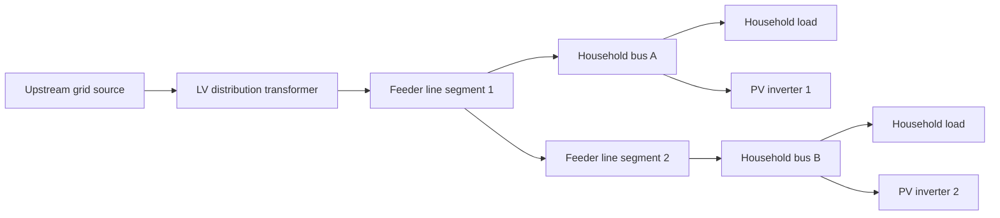
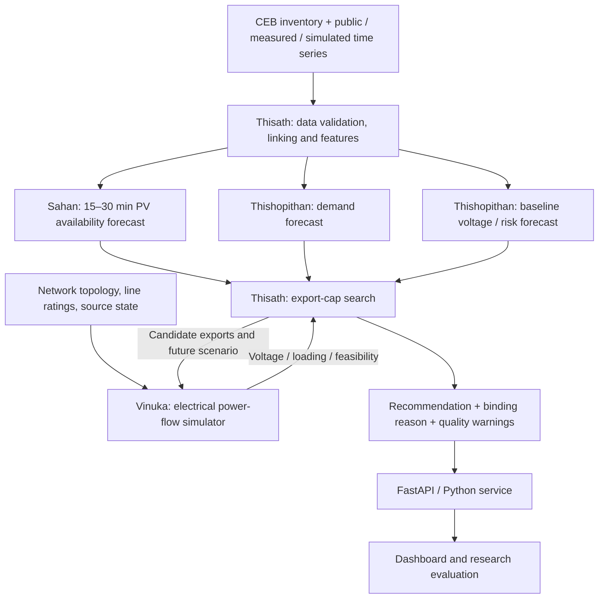
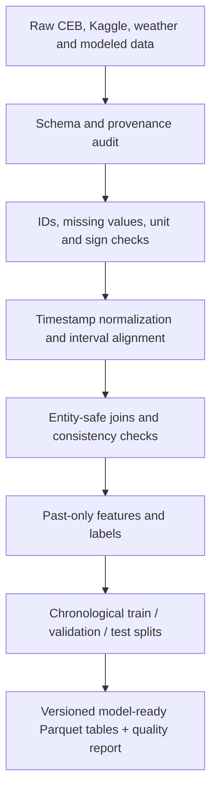

# Smart Solar Export Prediction to Prevent Inverter Shutdowns

**Comprehensive DSGP Project Guide — Project, Data, Architecture, Research, and All Four Components**

| Project information | Current position |
|---|---|
| Module | Second-Year Data Science Group Project (DSGP) |
| Group | Group 43 (as recorded in the earlier project compilation; verify against current university records) |
| Degree | BSc (Hons) Artificial Intelligence and Data Science |
| Institution | Informatics Institute of Technology (IIT), in collaboration with Robert Gordon University (RGU) |
| Working title | **Smart Solar Export Prediction to Prevent Inverter Shutdowns** |
| Main purpose | Predict/recommend a time-varying rooftop-PV grid-export limit that preserves feasible solar exports while addressing LV voltage and equipment constraints |
| Intended users | Researchers, distribution engineers, solar-system owners/installers, and academic evaluators |
| Geographic scope | **One selected Sri Lankan district**; Ratnapura is a proposed study district, not a verified location for every supplied CEB record |
| Prototype scope | One or a few selected LV networks/transformers, depending on defensible data availability |
| Forecast horizon | Initially **15–30 minutes ahead**; confirm that data resolution supports this |
| Delivery | **Software-based prediction, simulation, visualization, and decision support** — **no automatic commands to physical inverters** |
| Document updated | 12 November 2026 |
| Document status | Consolidated project reference and proposed implementation plan; **not** a statement that all models and tests have been completed |

> **How to interpret this guide:** “Agreed” describes decisions from the group discussions. “Proposed” describes an implementation or research choice that still needs testing or lecturer approval. “Documented dataset” means a data-description file lists it; this is not the same as independently verifying all underlying data bytes. Any numerical operating limits or examples below are **illustrative, not utility-approved settings**.

---

## Table of Contents

1. [Executive summary](#1-executive-summary)
2. [Problem and technical background](#2-problem-and-technical-background)
3. [Research aim, questions, objectives, and hypotheses](#3-research-aim-questions-objectives-and-hypotheses)
4. [Project scope, users, and deliverables](#4-project-scope-users-and-deliverables)
5. [Team structure and ownership](#5-team-structure-and-ownership)
6. [Member 1 — Thisath: Data preprocessing and dynamic export-limit optimization](#6-member-1--thisath-data-preprocessing-and-dynamic-export-limit-optimization)
7. [Member 2 — Sahan: Solar generation forecasting](#7-member-2--sahan-solar-generation-forecasting)
8. [Member 3 — Thishopithan: Electricity demand and grid-voltage prediction](#8-member-3--thishopithan-electricity-demand-and-grid-voltage-prediction)
9. [Member 4 — Vinuka: Electrical-grid simulation and network constraints](#9-member-4--vinuka-electrical-grid-simulation-and-network-constraints)
10. [System workflow and integration contracts](#10-system-workflow-and-integration-contracts)
11. [Data inventory, provenance, and availability](#11-data-inventory-provenance-and-availability)
12. [What data are still missing?](#12-what-data-are-still-missing)
13. [Data preprocessing and feature engineering](#13-data-preprocessing-and-feature-engineering)
14. [Prediction models and training methodology](#14-prediction-models-and-training-methodology)
15. [Export-limit optimization mathematics and algorithm](#15-export-limit-optimization-mathematics-and-algorithm)
16. [Simulation methodology, baselines, and experiments](#16-simulation-methodology-baselines-and-experiments)
17. [Evaluation and success criteria](#17-evaluation-and-success-criteria)
18. [System architecture, technologies, APIs, and repository](#18-system-architecture-technologies-apis-and-repository)
19. [Software requirements and user interface](#19-software-requirements-and-user-interface)
20. [Research approach, literature review, and novelty](#20-research-approach-literature-review-and-novelty)
21. [Project management, milestones, and deliverable checklists](#21-project-management-milestones-and-deliverable-checklists)
22. [Risks, ethics, limitations, and responsible reporting](#22-risks-ethics-limitations-and-responsible-reporting)
23. [Lecturer/viva explanations and answers](#23-lecturerviva-explanations-and-answers)
24. [Glossary, source register, and final checklist](#24-glossary-source-register-and-final-checklist)

---

## 1. Executive summary

Rooftop photovoltaic (PV) installations increasingly contribute electricity to Sri Lankan low-voltage (LV) distribution networks. When solar production is high and local consumption is low, large simultaneous exports can raise voltage at household connection points. If the voltage exceeds an inverter's configured protection limits for the relevant duration, that inverter may reduce its output or disconnect. At other times, network conditions may allow more export than a conservative fixed ceiling permits. The project therefore investigates **time-varying export recommendations** rather than treating full export or zero export as the only choices.

The proposed system combines four components:

1. **Thisath:** prepare linked datasets and recommend the **largest feasible export cap** subject to a documented set of network constraints;
2. **Sahan:** predict **available solar generation** for the upcoming 15–30-minute period;
3. **Thishopithan:** predict **electricity demand and grid-voltage conditions**, with clear assumptions about what his voltage model can and cannot estimate;
4. **Vinuka:** create an **electrical feeder model**, evaluate candidate exports by power flow, and report voltage, line-current and transformer-loading feasibility.

The software will combine the forecasts and network model, estimate a recommended export ceiling in kW, display the decision and reasons on a dashboard, and compare results against fixed-limit and other well-defined baselines. The project is a **research prototype**. It does not remotely control inverters, modify protection settings, or guarantee that an actual inverter will never disconnect.

**Simple illustrative case:** A rooftop PV installation could generate 4.4 kW, but its home is expected to use 0.9 kW, leaving up to about 3.5 kW available for net grid export. If network simulation finds 3.5 kW and 3.0 kW unsuitable but 2.5 kW feasible, the proposed optimizer could recommend a **2.5 kW net-export cap** for that scenario. This is *not* a rule derived from inverter rating alone. It depends on the whole network, applicable constraints, and assumptions about other connected systems.

### Planned contribution

The research contribution is a reproducible Sri Lankan LV-network **case study** linking short-term forecasts to **network-constrained export recommendations**, with transparent data provenance and evaluations of voltage compliance, retained exported energy, forecast error, robustness, and computation time. Related dynamic-export concepts already exist elsewhere; originality should be argued through the local scenario, methodology, data handling, or evaluation—not by claiming no similar idea exists.

---

## 2. Problem and technical background

### 2.1 What happens on a solar-rich LV feeder?

Consider several homes connected to a distribution transformer through LV cables. Around midday, their PV inverters may inject electricity toward the transformer. Depending on source voltage, feeder impedance, line length, phase connections, household load, and reactive power, voltage can increase toward the remote end of the line. Excessive sustained or instantaneous voltage may trigger an inverter's protection logic.

**A simplified cause-and-effect chain:**

```text
High solar irradiance + many PV installations
                   |
                   v
More PV generation; local demand may be relatively low
                   |
                   v
Higher reverse power flow on parts of the LV feeder
                   |
                   v
Possible voltage rise / current or loading constraints
                   |
                   v
Inverter output reduction or protection trip (depending on settings)
                   |
                   v
Lost export opportunity; possible interruption until reconnection
```

The system investigates whether forecasting and simulation can recommend an export amount that remains feasible under the modelled conditions, instead of assuming that every system should either export at full capacity or stop exporting.

### 2.2 Overvoltage is not the same as transformer overload

| Concept | What it means | What to inspect |
|---|---|---|
| **Overvoltage** | Voltage rises above the applicable operating/protection threshold at a node or inverter terminal | Voltage magnitude by phase, location, duration, source voltage and inverter settings |
| **Transformer overload** | Transformer current or apparent power exceeds an applicable thermal/operational rating | Rated kVA, phase currents, kVA, power factor, duration and thermal criteria |
| **Line overload** | A conductor's current exceeds its permitted current rating | Line current, conductor type, ampacity and applicable operating rules |
| **Reverse power flow** | Net real power moves from LV toward the upstream system | Signed active power and local generation/load; reverse flow is not necessarily itself a violation |
| **Inverter shutdown** | Inverter disconnects or stops exporting under protection/control logic | Alarm codes, voltage values, delay/reconnection settings and event history |

A transformer can be thermally overloaded without a local overvoltage, and an LV connection can experience high voltage while transformer loading remains within limits. **The project must check voltage and thermal conditions separately.**

### 2.3 Key electrical quantities

| Quantity | Typical unit | Meaning |
|---|---|---|
| PV DC nameplate capacity | kWp | Nominal peak panel-array rating under standard test conditions |
| Inverter AC rating | kW or kVA | Inverter's rated AC output capability |
| Instantaneous power | kW | Generation, load, import or export at a given interval |
| Energy | kWh | Power integrated over time |
| Transformer capacity | kVA | Apparent-power rating; not identical to kW without power factor |
| Voltage | V | Phase-to-neutral or phase-to-phase voltage; state which one |
| Current | A | Conductor current |
| Line resistance/reactance | Ω or Ω/km | Electrical parameters influencing voltage and losses |

For a 15-minute interval at an average export power of 2 kW, the exported energy is approximately **2 × 0.25 = 0.5 kWh**. A monthly kWh total does not reveal short-lived voltage peaks.

### 2.4 Why fixed export limits can be inefficient

A fixed 2 kW ceiling is simple but may restrict energy unnecessarily during low-demand-risk periods. Conversely, an unrestricted limit might violate network constraints during particularly high PV/low-demand periods. A dynamic limit varies with the predicted operating state. Its benefit must be **demonstrated** under a consistent simulator and objective, not assumed in advance.

### 2.5 Important distinctions for the whole project

- **PV generation ≠ PV export:** some electricity may be consumed on-site; storage can further change net flows.
- **Installed capacity ≠ actual generation:** capacity is static; output changes through the day.
- **Meter import ≠ gross load** when behind-the-meter PV/storage is present.
- **Historical actual export ≠ maximum feasible export:** a site might have exported less because of weather, self-consumption or curtailment.
- **Forecast voltage ≠ counterfactual voltage:** predicting a voltage under historical conditions does not automatically tell us what voltage would occur if proposed export caps were changed.
- **Simulation-based feasibility ≠ certified physical safety.**

---

## 3. Research aim, questions, objectives, and hypotheses

### 3.1 Main aim

**To develop and evaluate a software-based method for forecasting rooftop solar generation, electricity demand, and grid conditions and recommending suitable time-varying solar export limits for a selected Sri Lankan low-voltage distribution network, with the goal of preserving feasible export while reducing modelled overvoltage and equipment-loading violations.**

### 3.2 Three main research questions (proposed wording)

**RQ1 — Data and prediction:** How accurately can short-term rooftop PV generation, electricity demand, and LV-grid voltage conditions be predicted using available historical, weather, and network variables?

**RQ2 — Dynamic export calculation:** How can these predictions be combined with electrical-network constraints to estimate suitable time-varying rooftop solar grid-export limits?

**RQ3 — Effectiveness:** Under matched network simulations, how do the proposed dynamic export limits compare with fixed export limits in voltage compliance, transformer/line loading, and retained solar-export energy?

**Supplementary investigation:** How sensitive are recommendations to weather/forecast uncertainty, missing data, synthetic network parameters and phase imbalance?

### 3.3 Research objectives

| ID | Objective | Evidence/deliverable |
|---|---|---|
| RO1 | Review rooftop PV voltage-rise problems, export-management techniques, and existing research in Sri Lanka and elsewhere | Critical literature review and technical requirements |
| RO2 | Audit, link, preprocess, and document available CEB, public, weather, and simulated data | Cleaned versioned datasets, data dictionary, and quality report |
| RO3 | Develop and evaluate short-term PV-generation forecasts | Trained PV baseline and candidate models, MAE/RMSE plots |
| RO4 | Develop and evaluate electricity-demand and measured/baseline-voltage forecasts or risk predictions | Demand/voltage models, metrics and failure analysis |
| RO5 | Represent a selected LV feeder in a reproducible electrical power-flow simulator | Network assumptions, calibration checks and constraint outputs |
| RO6 | Develop an export-limit recommendation method based on forecast inputs and network constraints | Optimization engine, interface, recommendation examples |
| RO7 | Compare the method with fixed-cap and other justified baselines | Voltage/loading violation analysis, exported/curtailed kWh, runtime |
| RO8 | Integrate the four components into an explainable software dashboard and prepare academic documentation | API, interface, test evidence, final report and viva |

These are project-level proposed objectives, not an assertion that specific numerical targets have been achieved.

### 3.4 Testable hypotheses (examples)

- **H1:** Appropriate short-term models improve PV or load prediction error over persistence/seasonal baselines on held-out time periods.
- **H2:** Under the defined simulated network scenarios, a constraint-checked dynamic export method can retain more feasible solar-export energy than a selected conservative fixed cap, without increasing modelled constraint violations beyond the agreed threshold.
- **H3:** Forecast uncertainty and errors in network parameters materially affect recommended limits, motivating transparent uncertainty or safety margins.

If a hypothesis is not supported, report the result. Do not set hypotheses that depend on unknown field outcomes as guaranteed project claims.

---

## 4. Project scope, users, and deliverables

### 4.1 In scope

- One approved Sri Lankan district and a clearly identified small study network or a documented representative synthetic feeder if local detail is unavailable.
- PV, demand and voltage/risk forecasting at an achievable resolution, initially 15–30 minutes.
- Scenario-based grid simulation and export-cap estimation for one or more PV connection points.
- Evaluation against fixed-cap/unrestricted scenarios with consistent assumptions.
- Dashboard to visualize measured/simulated inputs, forecasts, recommendations, binding constraints and evaluation metrics.
- Versioned code, documented data provenance, unit tests, integration tests, academic report, presentation and reproducibility instructions.

### 4.2 Out of scope

- Operating physical inverters or sending export commands to them.
- Adjusting inverter overvoltage protection settings.
- Real-time utility dispatch, regulatory certification or guaranteed safe operation.
- Claiming that every inverter in a district can avoid shutdowns.
- Inferring equal allocation of export caps from the hypothetical “60 houses / 30 trips” explanation.
- Guaranteeing a positive export allowance if network constraints are violated even at zero export.
- Making financial-savings claims without a valid tariff and simulated production basis.

### 4.3 Stakeholders

| Group | What they need from the prototype |
|---|---|
| Solar owners | Understand estimated export opportunity and likely limiting conditions |
| Solar installers | Explore connection and export scenarios in the studied network |
| Distribution engineers / CEB or relevant licensee | Inspect assumed network constraints and scenario comparisons |
| Students, researchers and lecturers | Review methodology, reproducibility, metrics and limitations |
| General public | Understand the problem without needing specialist power-system knowledge |

### 4.4 Planned deliverables

Project proposal; literature review; SRS; stakeholder questionnaire; requirements and diagrams; data inventory and dictionary; preprocessing notebook/scripts; three forecasting tasks as assigned; electrical network simulator; optimization service; backend/frontend or justified simpler interface; testing/evaluation reports; demonstration; individual contribution records; final dissertation/report and viva preparation.

---

## 5. Team structure and ownership

| Member | Name | Component | Main output |
|---|---|---|---|
| **Member 1** | **Thisath** | Data Preprocessing and Dynamic Solar Export Limit Optimization | Clean linked datasets and a constrained export-cap recommendation in kW |
| **Member 2** | **Sahan** | Solar Power Generation Forecasting | Future available PV power in kW |
| **Member 3** | **Thishopithan** | Electricity Demand and Grid Voltage Prediction | Future demand in kW and baseline voltage/risk predictions |
| **Member 4** | **Vinuka** | Electrical Grid Simulation and Network Constraint Analysis | Candidate-cap feasibility, voltage/current/loading results |

**Shared responsibilities:** system integration, consistent API contracts, GitHub repository coordination, dashboard design, literature synthesis, testing, security and ethical reporting. Final ownership of the shared frontend should be agreed as a separate task assignment.

### 5.1 How independent development works

All members can build their own component using small prepared sample datasets and **mock interfaces**. This does **not** mean the final system is independent: the components are designed to work together.

| Member | Independent development input | What is needed later at integration |
|---|---|---|
| Thisath | Clean sample table + mocked `check_feasibility()` | Live forecasts from Sahan/Thishopithan and Vinuka's simulator |
| Sahan | PV/weather historical or synthetic samples | Same IDs, timestamps and horizon as backend |
| Thishopithan | Consumption/voltage historical or synthetic samples | Same network/time identifiers and weather/features |
| Vinuka | Synthetic feeder + manually assigned PV/load scenarios | Predicted load/PV and candidate export vectors |

**Contract-first development:** agree a shared data schema and function signatures before every component is finished. Develop using mocks, then replace mocks one by one. Report synthetic results as synthetic even if the application works correctly.

---

## 6. Member 1 — Thisath: Data preprocessing and dynamic export-limit optimization

### 6.1 Purpose and boundaries

Thisath owns **two closely connected responsibilities**: (A) preparing consistent, trustworthy input datasets for the team; and (B) calculating a recommended rooftop PV **net-export cap** under modelled network constraints. He is not responsible for building the PV forecast model or the electrical power-flow engine, although he must understand both interfaces.

### 6.2 Part A: Data preprocessing

**Inputs:** CEB transformer/customer/solar inventory; any available meter/voltage measurements; real or public weather; modeled generation/load/network records; data dictionaries and provenance flags.

**Tasks:**

1. **Audit files and schemas:** identify tables, columns, row counts, field types, sampling rates, missing entries and duplicates.
2. **Normalize identifiers:** preserve zero-padded IDs and anonymized links; create stable mappings such as `network_id`, `transformer_id`, `customer_id`, `pv_id`, `feeder_id` and `bus_id`.
3. **Join related records:** link PV system to customer; customer to transformer; where justified link customer to node/phase. Flag undocumented joins as provisional.
4. **Align time series:** standardize timezone to `Asia/Colombo`, identify each interval's start/end, align weather/PV/demand/voltage records, detect clock drift and gaps.
5. **Validate physical units:** distinguish kW/kWh/kVA/kWp/V/A and ensure interval energy is converted to average power correctly.
6. **Handle missing/outlier values:** investigate meter gaps and invalid values; do not remove real high-voltage readings merely because they are unusual. Preserve outage/trip conditions.
7. **Engineer predictors:** hour, day of week, weekend/holiday, cyclical time variables, previous 15-minute/one-day PV and load, previous measured voltage, irradiance, cloud, temperature and system capacity.
8. **Prevent leakage:** calculate lag features within each PV/customer series; avoid predictors containing future measurements or post-simulation target information; fit scalers/imputation on training data only.
9. **Produce chronological splits** appropriate to each model. If supplied files already contain an official `split` field, audit and preserve it unless a change is justified and documented.
10. **Export shared model-ready tables**, schemas, validation reports, and a data dictionary.

**Expected artifacts:** `data_dictionary.md`, quality audit, preprocessing scripts, cleaned Parquet files, join integrity tests, feature catalog, time-split report, and reproducibility notes.

### 6.3 Part B: Dynamic solar export-limit optimization

**Question:** Given the PV forecast, household load forecast and feeder constraints, **what is the greatest grid-export amount we can recommend for the chosen connection(s) without violating the modelled limits?**

**Inputs:**

- Available PV forecast per site (`pv_available_kw`) from Sahan;
- Gross demand forecast (`load_kw`) and grid-condition information from Thishopithan;
- Approved export cap/inverter power rating and relevant operating-policy settings;
- Network model and constraint-checking function from Vinuka;
- Configured voltage bounds, conductor ampacity, transformer limits and uncertainty margin;
- Time of forecast issue, target interval, network/phase/site identifiers.

**Outputs:** recommended cap in **kW at the grid connection point**, binding reason (voltage, line current, transformer, rating), feasibility status, model/constraint version, interval and supporting simulated values. A site-specific inverter generation cap is not always identical to a net-export cap.

### 6.4 Starting algorithm: Grid Search with feasibility checks

For one site, consider candidate net-export limits from 0 to its feasible physical/approved upper bound in small steps, such as 0.25 kW (step size is a design parameter). At each candidate, ask Vinuka's simulator to evaluate the **entire network operating state**. Select the highest tested candidate whose simulated voltage, line current and transformer loading meet all chosen constraints. If none is feasible, return a meaningful failure status rather than silently reporting “safe 0 kW”.

**Illustrative candidate test** (not measured data):

| Proposed cap (kW) | Simulated constraint result | Decision |
|---:|---|---|
| 3.5 | Overvoltage | Reject |
| 3.0 | Overvoltage | Reject |
| **2.5** | **All checked constraints satisfied** | **Choose if highest feasible** |
| 2.0 | Feasible | Feasible but more curtailed |

For multiple houses, the optimization becomes a **joint allocation problem**. A maximum computed for each home separately may not be simultaneously feasible when everyone exports. To keep the first prototype manageable, explicitly specify whether only one site is adjusted while other sites are fixed, whether one common feeder cap is tested, or whether a vector of site caps is jointly optimized. Fairness constraints are optional research choices, not already agreed requirements.

### 6.5 Algorithm boundaries and failure statuses

- `FEASIBLE`: at least one checked candidate satisfies all configured constraints.
- `NO_POSITIVE_EXPORT_FEASIBLE`: 0 kW feasible, positive candidates infeasible.
- `BASE_NETWORK_INFEASIBLE`: the network still violates constraints at zero PV export.
- `NONCONVERGENCE`: power flow did not converge; cannot declare feasibility.
- `INSUFFICIENT_DATA`: required forecast, topology or limits unavailable.
- `OUT_OF_DOMAIN`: prediction lies outside supported conditions.

A simple Grid Search is easy to implement, inspect and explain in a viva. More advanced constrained optimization or optimal power flow may be considered after the basic system works; binary search should not be used unless the required monotonicity assumptions are established.

### 6.6 How Thisath can work before Vinuka finishes

Create a **mock feasibility evaluator** with predefined voltage/loading responses and unit tests. It lets Thisath verify search logic, boundary checks, errors and API formatting. Replace the mock with Vinuka's tested power-flow interface later. The mock proves software correctness of the search, not real electrical feasibility.

### 6.7 Recommended tests and metrics

Data completeness, valid mappings, missing-time gaps, leakage, unit consistency, optimizer upper/lower boundaries, nonconvergence handling, feasibility rate, modelled violation rate, exported/curtailed kWh, runtime, uncertainty sensitivity, and comparison with fixed caps.

### 6.8 Suggested personal deliverables

- Data preparation specification and quality/EDA report;
- Shared cleaned datasets with provenance flags;
- Feature specification and leakage checks;
- Export-cap formulation, assumptions and constraints;
- Candidate-search function with mock and real feasibility adapters;
- API response and integration tests;
- Baseline comparison, stress tests and component report.

### 6.9 Short natural explanation for the lecturer

> My component has two parts. First, I clean and prepare the solar, electricity demand, weather and grid data so all members can use consistent datasets. Then I develop an optimization algorithm to recommend the highest feasible amount of electricity a rooftop solar system can export. The algorithm checks voltage, line current and transformer-loading limits through Vinuka's grid simulation. I can first develop and test my algorithm independently using a mock feasibility checker, and then connect it to the full system.

---

## 7. Member 2 — Sahan: Solar generation forecasting

### 7.1 Purpose and prediction target

Sahan develops a model that answers: **How much AC solar power will a rooftop PV system be able to produce over the next 15–30 minutes?** The preferred target is **available/uncurtailed PV generation in kW** rather than grid export or curtailed actual generation.

A 5 kW inverter does **not** constantly produce 5 kW. Output varies with irradiance, temperature, shading, equipment rating and other factors. Weather and historical PV patterns allow Sahan to estimate future production. His prediction tells Thisath what solar power may be available; it **does not** tell the optimizer what is electrically safe to export.

### 7.2 Exact datasets Sahan needs

| Dataset | Core columns | Purpose | Current evidence/status |
|---|---|---|---|
| **PV generation time series** | `timestamp`, `pv_id`, **`pv_available_kw`** | Target for supervised forecasting | Version 10 documentation lists a **synthetic** 15-minute available-PV target; actual PV measurements unconfirmed |
| **Weather history/forecasts** | `timestamp`, `ghi_wm2`, `temp_c`, `cloud_cover_pct`; optional `dni_wm2`, `dhi_wm2`, `rh_pct`, `wind_kmh` | Sunlight/weather input to PV prediction | Weather available per user; Version 10 describes real/derived and synthetic weather fields |
| **PV-system inventory** | `pv_id`, `inverter_ac_kw`, DC capacity if known, tilt, azimuth, derating | Scale and explain differences among systems | CEB capacity exists; several Version 10 equipment fields are assumed/synthetic |
| **Recent PV observations** | `pv_available_kw_lag_15min`, `pv_available_kw_lag_1day` | Autoregressive features | May be generated if true observations are available at issue time |
| **Future weather forecast** | Irradiance/cloud/temp forecasts issued before the prediction target time | Valid operational forecasting | Must be a real forecast available at issue time, not future observed weather |

**Important:** If Sahan uses synthetic `pv_available_kw` as the target, he is learning the behaviour of a synthetic PV production model. He can demonstrate a machine-learning pipeline, but the model's test score alone **does not establish accuracy for real Sri Lankan PV systems**. Real inverter AC production measurements would substantially strengthen validation.

### 7.3 Recommended input-feature table

| Feature | Why useful | Essential? |
|---|---|---|
| `timestamp` | Identify order, forecast horizon and season | Yes |
| `pv_id` | Distinguish installations | Yes for multi-system modelling |
| `ghi_wm2` | Main sunlight-intensity indicator | Strongly recommended |
| `temp_c` | Correlated with panel heating/performance | Recommended |
| `cloud_cover_pct` | Fast variation in sunlight | Recommended |
| `inverter_ac_kw` | Rated AC limit | Recommended |
| `dni_wm2`, `dhi_wm2` | Direct/diffuse irradiance | Useful |
| `hour`, `day_of_year`, `hour_sin/cos` | Daylight and seasonal cycles | Useful |
| Lagged generation | Very useful short-horizon signal | Only if genuinely available when forecasting |
| `pv_available_kw` at the target timestamp | **Output label, not a feature** | Yes for supervised learning |

### 7.4 Recommended model-development steps

1. Select the prediction horizon: first **15 minutes**, then evaluate **30 minutes**.
2. Link the weather, PV inventory and generation series by PV ID, network and timestamp.
3. Explore solar output curves, night values, capacity normalization, missing periods and abnormal samples.
4. Build a **persistence baseline** (latest PV value) and/or a simple physical clear-sky/pvlib baseline. Baselines establish whether ML truly improves prediction.
5. Start with **Linear Regression** or a **Random Forest regressor**; compare **XGBoost** if time permits.
6. Train on earlier months, tune on a later validation period, and evaluate once on the latest held-out period. Avoid random shuffling of adjacent intervals.
7. Evaluate **MAE and RMSE in kW** and optionally normalized error by inverter capacity. Report daytime/high-solar subsets because many overnight zeros can make a model look artificially accurate.
8. Check bias/overprediction: a systematic overprediction could make the optimizer assume more PV is available than reality.
9. Save model, scaler if used, feature list, horizon, issue-time logic, version, metrics and output schema.
10. Expose `forecast_pv(network_id, pv_id, issued_at, horizon_minutes) -> PVForecast`.

### 7.5 Example (illustrative)

| Target time | Weather irradiance (W/m²) | Cloud (%) | Predicted available PV power (kW) |
|---|---:|---:|---:|
| 10:00 | 650 | 30 | 3.1 |
| 10:15 | 720 | 20 | 3.5 |
| 10:30 | 850 | 10 | 4.2 |
| 10:45 | 590 | 50 | 2.8 |

These are hypothetical example rows, not actual training outcomes. A 4.2 kW **generation forecast** must not be interpreted as a 4.2 kW available **net export** if there is on-site consumption.

### 7.6 Independence, tests and deliverables

Sahan can build a forecasting baseline with his own PV/weather sample and stub the backend output. No grid-line impedance or pandapower model is needed to develop his ML code. He ultimately needs the agreed IDs/horizon and preferably real PV measurements for independent validation.

Deliverables: PV data understanding/EDA, features, chronological split, baselines, trained model, evaluation charts, error report, serialized model, reproducible prediction function/API, tests and component explanation.

### 7.7 Short natural explanation for the lecturer

> My component is Solar Power Generation Forecasting. I use historical solar generation and weather data, such as sunlight, temperature and cloud cover, to predict how much electricity a rooftop solar system can generate in the next 15 to 30 minutes. I train and evaluate forecasting models, then send the predicted available solar power to the export optimization component. I predict generation, not the safe grid export limit.

---

## 8. Member 3 — Thishopithan: Electricity demand and grid-voltage prediction

### 8.1 Purpose

Thishopithan develops two related prediction tasks:

1. **Electricity demand forecasting:** How much electricity will homes or the feeder consume over the next 15–30 minutes?
2. **Baseline grid-voltage / overvoltage-risk forecasting:** Given the recent measured state, weather, time, load and PV conditions, what voltage or risk is expected under a clearly defined baseline/operating scenario?

High PV output alone does not determine overvoltage risk. **Demand, phase allocation and electrical conditions** matter. His forecasts help Thisath and Vinuka create the future network operating scenario.

### 8.2 Demand forecasting datasets

| Data | Typical columns | Important note |
|---|---|---|
| Customer or feeder load time series | `timestamp`, `customer_id`, `load_kw` or feeder `load_kw` | Preferred supervised target is **gross load** if available |
| Smart-meter history | `importkwh(kwh)`, `exportkwh(kwh)`, `avgimportkw(kw)`, `avgexportkw(kw)` | Grid import/export **does not automatically equal gross household load** |
| Calendar features | Hour, weekday, weekend, public holiday, Poya day | Must reflect Sri Lankan calendar and target date |
| Weather | Temperature, humidity, cloud | Can influence load demand |
| Customer information | Meter/customer ID, broad class or tariff | Only if lawful, relevant and documented |
| Lagged demand | Last 15 min, previous day/week for the same site | Must be computed within each entity without leakage |

Your `column_names.md` lists Sri Lankan Kaggle **15-minute smart-meter** import/export and voltage data, a **six-hour** dataset and **monthly** consumption data. These provide valuable development sources, but different intervals should not be treated as equivalent, and they may not match CEB customers in your chosen study feeder.

The newer Version 10 documentation identifies `customer_load_15min.parquet` with `load_kw` as its target. Its provenance is **real Kaggle load profiles reassigned to model customers**, with some synthetic commercial load. It is not direct meter observation for each mapped CEB connection.

### 8.3 Voltage forecasting datasets

| Data | Typical columns | Why needed |
|---|---|---|
| Measured voltage time series | `timestamp`, `avgvoltage(v)` or phase-specific voltages | The prediction target if measured locally |
| Recent voltage readings | Previous 15/30/60-minute voltage, variation | Captures current grid state |
| PV available/actual export | PV injection by site/phase | Strong driver of voltage rise |
| Load/import/export | kW by site or feeder | Represents local demand and reverse flow |
| Source voltage/transformer readings | Phase voltage upstream, loading | Helps model external variation |
| Topology/location/phase | Node ID, phase, feeder, distance/impedance when known | Needed for explaining spatial differences |
| Weather/time | Irradiance, temperature, cloud, hour | Helps explain PV and time-varying conditions |

The Kaggle smart-meter schema includes `avgvoltage(v)`, `phaseainstvoltage(v)`, `phasebinstvoltage(v)` and `phasecinstvoltage(v)`. **Verify the actual rows, sampling and relevance** before claiming these are ground-truth voltages from your selected CEB feeder.

### 8.4 What should the voltage model predict?

Define one target carefully:

- **Regression:** next-interval measured voltage in **V** for a specific site/phase, or
- **Classification:** whether the next interval is likely to exceed a specified, documented voltage threshold.

The threshold must be obtained from applicable study rules/protection settings; do not assume one universal threshold. If using modelled voltage rather than measurements, label the outcome **synthetic/simulated**.

**Counterfactual limitation:** A historical regression model predicts voltage under the distribution of past operating conditions. If the optimizer asks “What voltage would occur if we change 30 systems' export limits?”, Vinuka's **network simulation** must evaluate that alternative. The voltage forecast alone cannot prove the new export plan is safe.

### 8.5 Steps and evaluation

1. Identify whether the available target is gross demand, net import or net flow; document it accurately.
2. Audit timestamps, missing records, day/night behaviour, weekday effects and voltage extremes.
3. Develop baselines: latest value for voltage, same-time previous day/week for demand.
4. Engineer lagged measurements, rolling statistics using only past intervals, calendar/weather and network features.
5. Train Random Forest/XGBoost (or a simpler linear baseline); use chronological validation and held-out testing.
6. Report **MAE and RMSE** for demand (kW) and voltage (V); for risk classification report precision, recall, F1 and false-negative rate.
7. Break out errors on **sunny/low-demand** periods, not only average periods.
8. Return forecast values with target time, network/site/phase, version, provenance and uncertainty/quality flags.

### 8.6 Independence and integration

Thishopithan can train with existing historical or documented synthetic data independently of Sahan. At integration he can accept Sahan's PV forecast as a planned predictor, but only if training/inference use equivalent information available at prediction time. If his model requires future actual PV readings, it will not be valid operationally.

Outputs: `forecast_demand()` and `predict_voltage()` or `predict_overvoltage_risk()`. The **simulator** remains responsible for testing modified export scenarios.

### 8.7 Short natural explanation for the lecturer

> My component is Electricity Demand and Grid Voltage Prediction. I use historical electricity consumption, voltage and weather data to predict future demand and possible overvoltage conditions. These predictions help the system understand periods when high solar generation and low electricity consumption may create problems. The final export recommendations are then checked through the grid simulation rather than relying only on my predicted voltage.

---

## 9. Member 4 — Vinuka: Electrical-grid simulation and network constraints

### 9.1 Purpose

Vinuka builds a **virtual electrical distribution network** and tests what happens when PV exports and loads change. He answers the question: **Does this proposed vector of solar exports satisfy the modelled electrical operating constraints?**

This is the key distinction between **optimization** and **simulation**:

- **Thisath's optimizer** proposes and searches for candidate export caps.
- **Vinuka's simulator** calculates voltage, currents and equipment loading for the **whole feeder** under those candidates and reports feasibility.

### 9.2 Required datasets

| Data | Required fields | Why |
|---|---|---|
| Transformer inventory | ID, rated kVA, rated HV/LV voltages, impedance, taps | Upstream source/equipment representation |
| LV connectivity | `from_bus`, `to_bus`, feeder IDs, service connection mapping | Model physical power-flow paths |
| Cable/line data | Segment length, R, X, ampacity, conductor type | Compute voltage rise and line loading |
| Phase allocation | A/B/C/ABC for each load and inverter | Model imbalance and worst-phase voltages |
| PV installation data | Node, inverter AC rating, PV capacity, export approval, phase | Apply generation and cap constraints |
| Load profiles | Site/phase/time and kW/kVAr | Represent network demand |
| Source voltage/measurements | Phase voltage, currents, transformer load | Calibrate/test simulated electrical behaviour |
| Inverter protection characteristics | Voltage thresholds, durations and reconnection behavior | Only if modeling actual trip events rather than voltage violation proxies |

The uploaded CEB spreadsheet gives transformer/customer **inventory and potential ID associations**, but geographical coordinates alone are not a valid electrical one-line diagram. The Version 10 dataset description includes **synthetic** bus/line layouts, phase assignments and power-flow outputs; use them as a **clearly labelled model**, not as verified CEB wiring.

### 9.3 Simulator choice

Two options were discussed:

- **pandapower (Python):** useful for a Python-based power-flow workflow and basic LV modeling. Verify the chosen modelling approach supports the required per-phase unbalance and constraints.
- **OpenDSS with DSS-Python:** a strong alternative for distribution-feeder and unbalanced multi-phase simulation, mentioned in a later proposal.

Choose **one primary engine** after a small feasibility test and coordinate with the lecturer. Don't silently mix results from different simulators without matching assumptions. For the current role descriptions, pandapower remains a reasonable initial implementation example, but the exact engine is **not conclusively finalized**.

### 9.4 How the virtual network works



Each bus and line has electrical parameters. The simulator receives **net active/reactive injections** for the future interval, calculates a power-flow solution, and reports conditions at nodes and equipment.

### 9.5 Typical simulation output

| Output | Meaning |
|---|---|
| `converged` | Whether the power-flow algorithm returned a valid solution |
| `voltage_v_by_bus_phase` | Calculated bus voltages at relevant nodes/phases |
| `line_current_a` | Current in each line/phase |
| `line_loading_pct` | Relative loading against each conductor's limit |
| `transformer_loading_pct` | Relative transformer loading against defined rating |
| `reverse_power_flow_kw` | Net reverse real-power flow, if present |
| `violations` | Documented set of exceeded limits and locations |
| `feasible` | True only if solution converged and **all specified constraints** passed |

### 9.6 Independent development and tests

Vinuka can begin with an openly documented **synthetic benchmark feeder** and manually assigned PV/load values. He should first test no-PV, high-PV/low-load, high-demand, long-feeder and single-phase cases; confirm voltage and current response makes engineering sense. Later he links forecasts from the other members.

He must distinguish:

- Modelled line connectivity vs GPS-derived guesses;
- Verified equipment parameters vs assumed parameters;
- Power flow convergence vs actual constraint compliance;
- Reverse flow vs transformer overload;
- Voltage violations vs real inverter trips (which depend on time delays/protection curves).

### 9.7 Suggested deliverables

Network model files, parameter-provenance table, line/bus diagram, power-flow tests, feasibility-checking function, plotted voltage profiles, voltage/current/transformer violation flags, scenario comparison tables, known limitations, integration tests and component report.

### 9.8 Short natural explanation for the lecturer

> My component is Electrical Grid Simulation. I build a virtual distribution network using a tool such as pandapower and test how different solar export levels affect voltage, line currents and transformer loading. When Thisath's optimizer proposes an export limit, my simulator checks whether that limit satisfies the modelled electrical constraints. I can develop and test the network independently using sample data before the components are integrated.

---

## 10. System workflow and integration contracts

### 10.1 End-to-end flow



**Operational distinction:** If the architecture runs Vinuka's simulator at each candidate during recommendations, that is a **forecast-driven constrained optimization system**. A separately trained direct model of the maximum feasible export cap is an **optional alternative**: first generate trusted feasible-cap labels offline from network simulation, then predict them with a model. Do not claim both paths are already implemented.

### 10.2 Proposed core software contracts

```python
forecast_pv(network_id, pv_id, issued_at, horizon_minutes) -> PVForecast
forecast_demand(network_id, issued_at, horizon_minutes) -> DemandForecast
predict_voltage(network_id, issued_at, horizon_minutes) -> VoltageForecast
check_feasibility(network_id, scenario_at, pv_export_caps_kw, demand_kw, source_state) -> FeasibilityResult
recommend_export_limit(network_id, scenario_at, forecasts, constraints) -> ExportRecommendation
```

**PVForecast** should contain `pv_id`, target time, estimated available AC kW, horizon, model/version and quality/provenance status.

**DemandForecast** should contain node/customer or feeder IDs, target time, kW (and kVAr if available), model/version and quality/provenance.

**VoltageForecast** should identify what is being predicted: baseline node/phase voltage, transformer source voltage, or threshold risk. It is not a replacement for counterfactual power-flow checks.

**FeasibilityResult** should contain convergence, all relevant voltages/current/loading values, violated limits and assumptions. `feasible` is true only when every configured check passes.

### 10.3 Example recommendation response (illustrative)

```json
{
  "network_id": "T110",
  "pv_id": "T110_PV003",
  "issued_at": "2024-07-12T11:00:00+05:30",
  "target_at": "2024-07-12T11:15:00+05:30",
  "horizon_minutes": 15,
  "pv_available_kw": 4.2,
  "gross_household_load_kw": 1.0,
  "maximum_net_export_possible_kw": 3.2,
  "recommended_net_export_cap_kw": 2.5,
  "status": "FEASIBLE_IN_SIMULATION",
  "binding_constraint": "phase_voltage",
  "constraint_check": "modeled_power_flow",
  "provenance": "illustrative_synthetic_example",
  "model_version": "demo-0.1"
}
```

All values above are **example outputs**, not observed or validated results. For multiple PV sites, the request and result should contain a consistent vector of site limits; the simulator checks all of them together.

### 10.4 Interface rules all four members must follow

1. Adopt a single `Asia/Colombo` timezone, with ISO 8601 offset-aware timestamps.
2. Distinguish **forecast issue time** from **target/valid time**.
3. Document whether measurements represent interval start, end or average.
4. Define positive/negative signs for import, export and reactive power.
5. Identify whether a quantity is measured, public-derived, re-assigned, synthetic, predicted or power-flow calculated.
6. Keep `kW`, `kWh`, `kVA`, `kVAr`, `V`, `A` and `Ω` separate.
7. Return explicit errors for missing inputs, zero-export infeasibility, failed convergence and unsupported horizons.
8. Version the network, training set, model, baseline and constraint settings.
9. Reject fabricated “success” responses for missing data.
10. Agree on a small common test fixture for integration.

---

## 11. Data inventory, provenance, and availability

### 11.1 Data source categories

| Category | Meaning | Reporting rule |
|---|---|---|
| **REAL / recorded** | Historical measurements or utility-recorded asset values | State collection source, place, dates and units |
| **REAL-DERIVED** | Computed from genuine public observations, such as processed weather | Show transformation and resampling |
| **REAL (re-assigned)** | Real donor measurements mapped onto another model customer | Not field-measured at that new customer's location |
| **SYNTHETIC** | Generated by assumptions, physical model or simulation | Label as synthetic/simulation-based |
| **FORECAST** | Output of a trained/modelled predictive method | Provide issue time, horizon and model version |
| **UNCONFIRMED** | File is described or reported but underlying values have not been verified | Avoid claiming completeness or measured accuracy |

### 11.2 Original CEB/utility spreadsheets

Earlier spreadsheet audit recorded:

| File | Sheet | Records | Main contents |
|---|---|---:|---|
| `Feeder Data(1).xlsx` | `sjp5` | **127** | Transformer/asset inventory: IDs, location, nominal capacity and kV/code fields |
| `Feeder Data(1).xlsx` | `sjp5c` | **13,593** | Customer/connection inventory and coordinates |
| `Feeder Data(1).xlsx` | `see6` | **21** | Additional asset records |
| `Feeder Data(1).xlsx` | `see6c` | **17** | Additional customer records |
| `Solar Data(1).xlsx` | `Sheet1` | **1,593** | Solar account ID, `GenCapacity`, coded account/area fields |

**Original solar columns:** `AcctNo`, `AccountType`, `GenCapacity`, `AreaId`.

**Transformer inventory columns:** `AreaId`, `EcscId`, `SectionId`, `Sin`, `Name`, `Lon`, `Lat`, `Capacity`, `kV`, `TypeId`.

**Customer inventory columns:** `AcctNo`, `AreaId`, `EcscId`, `Lon`, `Lat`, `GpsAccuracy`, `NoPhX`, `Tariff`, `Sub`, `CustomerTypeId`, `MeterType`, `AccountType`, `ConnectionType`, `Finalized`.

**Linkage finding:** all **1,593** solar installation accounts were found in the main `sjp5c` customer inventory. The candidate mapping from customer `Sub` to transformer `Sin` through matching area/office codes worked in the earlier audit, **but its engineering meaning still needs utility confirmation**. Locations and IDs do not provide line routes or impedance.

**Data quality findings:** `sjp5c` had about **114** records lacking both coordinates, **1,410** missing `NoPhX` values, and many missing `MeterType` entries. A “1 or 3 phases” count is **not** the same as knowing phase A/B/C connection. The exact meaning and units of `Capacity`, `GenCapacity`, and coded fields should not be assumed without the utility data dictionary. The `kV` field is not a historical household LV-voltage time series.

### 11.3 Public Sri Lankan residential smart-meter dataset (documented in `column_names.md`)

| Data | Typical columns | Resolution | Interpretation |
|---|---|---|---|
| `monthly_consumption.csv` | `household_ID`, `month`, `consumption` | Monthly | Long-term consumption patterns, not 15-min network dynamics |
| `smart_15min_1/2/3.csv` | `household_ID`, `timestamp`, `importkwh(kwh)`, `exportkwh(kwh)`, `avgimportkw(kw)`, `avgexportkw(kw)`, `avgvoltage(v)`, phase voltage/current | **15 minutes** | Useful measured smart-meter series, subject to actual file audit |
| `smart_6hour_1…5.csv` | Date/time, total import/export, per-phase current/voltage | **6 hours** | Useful coarse historical data; not equivalent to 15-minute behaviour |
| Survey-wave files | House type, appliances, PV ownership and behaviour | Survey | Optional contextual research features; not direct instantaneous load/voltage data |

The Markdown schema describes **42 CSV files** across categories; the user earlier said they had two CSVs and an MD file. The presence of column names or a file reference does **not** prove that every one of those 42 files is present or suitable. Check the actual two CSVs before declaring coverage.

### 11.4 Weather data

The user has already obtained weather data. Documented weather fields across the project include:

`timestamp`, `ghi_wm2`, `dni_wm2`, `dhi_wm2`, `temp_c`, `rh_pct`, `cloud_cover_pct`, `wind_kmh`, with optional precipitation, sun-angle and clear-sky variables.

In the Version 10 documentation, 15-minute weather rows are **mostly real-derived**, sourced from hourly public weather inputs, while some high-frequency variability fields are **synthetic**. A 15-minute interpolation of hourly observations does not create measured quarter-hour cloud transients. Historical observations are also not the same as weather forecasts that would have been issued before each target time.

### 11.5 New Data Set Version 9 / Version 10 (documented project data pack)

Later project documentation describes a larger **model-ready dataset pack** for three example networks:

- **T110**: 48 PV systems;
- **T91**: 28 PV systems;
- **T65**: 32 PV systems;
- **Total**: **108 PV systems** in this modelled pack;
- **Time coverage described**: **2023-11-01 00:00 to 2024-10-31 23:45**, at 15-minute intervals;
- **Status:** descriptions are in `New Data Set Column Names Version 09.md`, `New Data Set Column Names Version 10.md` and `DSGP_Raw_Datasets_By_Member.md`. This guide relies on the **documented inventory and provenance**, not a new full audit of all source Parquet files.

The Version 10 inventory documents these especially relevant files:

| Dataset | Main role | Important provenance warning |
|---|---|---|
| `network/transformer.parquet` | Transformer capacity/source properties | Mixed real and assumed/synthetic electrical properties |
| `network/customers.parquet` | Customer/site and phase-related data | CEB IDs/capacities mixed with synthetic phase/service assumptions |
| `network/pv_systems.parquet` | PV IDs, capacity, inverter configuration | CEB `GenCapacity` is recorded; inverter AC rating, tilt, azimuth and protection attributes include assumptions/synthetic settings |
| `network/buses.parquet` / `lines.parquet` / `linecodes.parquet` | Electrical topology and conductor parameters | **Synthetic topology/line model**, not verified physical LV wiring |
| `timeseries/customer_load_15min.parquet` | Gross load target `load_kw` | **Real donor Kaggle profiles re-assigned** to customers, plus synthetic commercial profiles |
| `timeseries/pv_generation_15min.parquet` | `pv_available_kw`, `pv_actual_kw` | **Synthetic PV generation**, even when weather is real-derived |
| `timeseries/weather_15min.parquet` | Irradiance, temperature, clouds and more | Real, real-derived and some synthetic weather features |
| `timeseries/smart_meter_15min.parquet` | Model-site electrical readings | Simulated/reconstructed for the modelled network, not necessarily measured at the mapped CEB sites |
| `timeseries/transformer_15min.parquet` | Transformer voltage, currents, P/Q, loading | Largely **synthetic power-flow outputs** |
| `timeseries/line_loading_15min.parquet` | Line current/loading outputs | **Synthetic power-flow outputs** |
| `events/inverter_events.parquet` | Tripping/reconnection events | **Synthetic event model** |
| `events/daily_voltage_summary.parquet` | Daily synthetic voltage extremes | **Simulation derived** |
| `validation/metrics.parquet` | Network data-model checks | Checks the model/pack, not proof of real-world forecasting accuracy |

**Very important:** The presence of a `pv_available_kw` column is useful for training a proof of concept, **but Version 10 explicitly labels that target synthetic**. Similarly, `load_kw` may come from a real household donor series while its placement on a specific CEB customer is synthetic/re-assigned. The final report must not call these all “real CEB measurements.”

### 11.6 Other model-ready tables mentioned in recent discussions

A recent schema described **`solar.parquet`** with **27 columns**, targeting `pv_available_kw`, including `network`, `timestamp`, `split`, `pv_id`, `customer_id`, `feeder_id`, `inverter_phase`, `ceb_gen_capacity`, `inverter_ac_kw`, `ghi_wm2`, `dni_wm2`, `dhi_wm2`, `temp_c`, `rh_pct`, `cloud_cover_pct`, `wind_kmh`, weather lags and previous PV power. **`demand.parquet`** was separately described as targeting `load_kw` (19 columns were reported). The precise row data and completeness were not independently rechecked here.

If using these derived tables, confirm how they were constructed from the Version 10 raw pack, whether `split` is chronological, and whether lag features or target-derived columns leak future information. Do not present derived tables as a second independent field dataset if they were generated from the same simulated records.

### 11.7 Data coverage matrix

**Legend:** ✓ = documented/available source; ~ = reported/documented but suitability or provenance requires checks; × = no verified real local source identified.

| Requirement | Current evidence | Usable for prototype? | Enough for local field validation? |
|---|---|---|---|
| Transformer IDs, customer coordinates, approximate inventory | ✓ CEB spreadsheets | **Yes** | Partial; schema meanings need confirmation |
| Installed solar-capacity field | ✓ Solar spreadsheet / model pack | **Yes**, after unit confirmation | Partial; not generation time series |
| 15-minute residential import/export & voltage | ~ Kaggle smart-meter files listed in MD | **Potentially** | **No**, if not from the selected CEB feeder |
| Gross household demand `load_kw` | ~ Version 10 real donor profiles + synthetic loads | **Yes**, model development | **No**, mapped site load is not field-observed |
| Weather/irradiance | ✓ User-reported weather and Version 10 weather | **Yes** | Helpful; local measurement accuracy varies |
| Available solar generation `pv_available_kw` | ✓ Version 10 synthetic target | **Yes**, for simulated training | **No**, needs real PV production data |
| PV actual power and trips | ~ Version 10 synthetic | **Yes**, only as simulation | **No**, needs inverter/meter logs |
| LV feeder topology and line impedances | ~ Synthetic Version 10 network model | **Yes**, under assumptions | **No**, needs verified topology/parameters |
| Customer-specific phase assignment | ~ Synthetic imputation in model pack | **Yes**, for test scenarios | **No**, needs utility/field confirmation |
| Time-aligned transformer and end-of-feeder voltage | ~ Synthetic Version 10 electrical outputs | **Yes**, simulation evaluation | **No**, needs measured electrical time series |
| Actual operating export approvals/limits | ~ CEB capacities / modelled assumptions | Cautiously | **No**, approvals must be confirmed |
| Utility-approved dynamic export-limit labels | × Not demonstrated | Can generate **simulation-based labels** | **No**, field-validated labels unavailable |

---

## 12. What data are still missing?

The key question is **missing for which claim?** You already have enough documented material to start a reproducible simulated prototype. You still lack sufficient evidence to claim the final predictor is validated on a real CEB LV feeder.

### 12.1 Priority requests to the relevant distribution utility

| Priority | Request | Why it matters | Responsible member(s) |
|---|---|---|---|
| **Critical** | One complete selected LV feeder one-line/network connectivity diagram, node-to-node conductor lengths, R/X and ampacity | Converts synthetic feeder assumptions into a real supported electrical model | Vinuka, Thisath |
| **Critical** | Transformer rated primary/secondary voltage, kVA, impedance, vector group, tap position, and phase mapping | Needed for reliable power-flow assumptions | Vinuka |
| **Critical** | Customer and PV single/three-phase **A/B/C/ABC assignments**, connection nodes | Model phase imbalance and connection-specific constraints | Vinuka |
| **Critical** | Overlapping timestamped phase voltages, current, P/Q and transformer loading for the selected network | Calibrate/validate voltage/loading predictions and simulation | Thishopithan, Vinuka |
| **High** | Time-matched gross load or import/export per site/feeder with unambiguous sign conventions | Validate local demand forecasts and scenario loads | Thishopithan |
| **High** | Real inverter AC generation, grid export, and usable availability/curtailment status | Validate Sahan's PV forecast and relate power to feasible export | Sahan, Thisath |
| **High** | Actual export approvals, inverter nominal ratings, and documented relevant voltage operating/protection settings | Proper operating/engineering upper bounds and trip interpretation | Thisath, Vinuka |
| **Useful** | Inverter high-voltage event timestamps, trip reasons/delays, reconnection and pre-event voltage | Evaluate actual trip prediction rather than only a voltage-violation proxy | Thishopithan, Vinuka |
| **Useful** | Utility-validated feasible export envelopes or historical connection-study results | Better independent benchmark for maximum-feasible-cap labels | Thisath |

**Preferred period:** approximately **6–12 months** of overlapping records at **5–15-minute** resolution where possible, all for the same anonymized network and consistent timezone. Higher-frequency voltage/event logs are helpful for trips, because 15-minute average voltages can hide short threshold exceedances.

A small **well-characterized feeder** is better than a large set of static customer locations without usable electrical parameters. Request anonymized IDs rather than personal names/accounts.

### 12.2 If no more CEB data are released

The team can still deliver a valid **simulation-based academic proof of concept**, provided it:

- clearly marks real CEB inventory, real-derived weather, re-assigned load and synthetic topology/generation;
- avoids claims of verified local inverter protection improvement;
- documents every network parameter assumption;
- tests scenario and parameter sensitivity;
- treats predicted cap values as **model-derived**, not field-certified limits;
- discusses transferability and requests future field validation in the limitations section.

### 12.3 Sahan-specific gap

Sahan already has a **synthetic** generation target in the documented dataset pack and weather drivers, which are enough to train a demonstration model. His main scientific gap is **actual historical PV generation/availability measured from the same or comparable real installations**. Utility net export alone may not provide uncurtailed PV production without behind-the-meter context.

---

## 13. Data preprocessing and feature engineering

### 13.1 Recommended ETL pipeline



### 13.2 Data-cleaning checklist

- Preserve raw files unmodified and track source/license/collection date.
- Read account and site IDs as **strings** so no leading zeros are lost.
- Replace meaningful missing encodings (blank, `NULL`) carefully; do not interpret zero as missing without evidence.
- Inspect repeated timestamps per site and impossible negative PV production, while permitting legitimate signed import/export depending on conventions.
- Verify 15-minute coverage and identify clock gaps rather than silently forward-filling entire missing days.
- Flag nighttime PV, zero-generation during outage, curtailment, and sensor errors differently.
- Confirm whether an interval's reported kWh is a total for that 15-minute period or a cumulative meter register.
- Verify feature values at **forecast issue time**, not merely whether columns exist historically.
- Avoid using a simulator's future result (e.g., a future voltage-violation flag) as an input feature to the forecasting task.

### 13.3 Energy-to-power conversion

If `energy_kwh` means energy in one **15-minute interval**, then:

```text
average_power_kw = interval_energy_kwh / 0.25
```

Example: 0.75 kWh imported over 15 minutes corresponds to **3.0 kW average import**. If a column is a cumulative meter register, first calculate interval differences after checking resets and rollover. Do not treat cumulative totals as per-interval energy.

### 13.4 Feature types

| Feature family | Examples | Leakage precautions |
|---|---|---|
| Time | hour, minute, day of week, month, day/night, cyclical encodings | Use target calendar values if known in advance |
| Weather | irradiance, temperature, cloud cover and forecasts | **Future forecast**, not future observed weather, in live-style tests |
| Historical PV | last 15-minute output, previous day, rolling past hour | Lags within each PV ID; never shift across sites |
| Historical demand | previous intervals, recent rolling demand, holiday flags | Rolling windows must be past-looking |
| Electrical state | last valid phase voltage, transformer load, known source voltage | Must be available at prediction time |
| Installed assets | inverter rating, CEB capacity, phase and network ID | Mark assumed phase/rating separately from verified |
| Data quality | missing sensor flag, synthetic/real source, recency of last reading | Do not mask missing values as physical zeros |

### 13.5 Splitting and validation

- Prefer **chronological split** (earlier period for train, middle for tuning, latest for final test).
- If the goal is generalization to unseen transformers, include an **entire-network held-out evaluation** in addition to chronological tests where feasible.
- The training, validation and test sets must not share future-target information through lags, overlapping label windows or preprocessing fitted on all data.
- If multiple synthetic outputs were generated from the same simulator and parameter assumptions, results test **generalization within the simulator**, not real-world generalization.
- Keep a reproducible `split` field, random seeds for model tuning, and explicit forecast issue-time logic.

---

## 14. Prediction models and training methodology

### 14.1 Model matrix

| Component | Main target | Suggested baselines | Candidate models | Metrics |
|---|---|---|---|---|
| Sahan — PV | `pv_available_kw` (future available AC power) | Persistence, simple solar physical/clear-sky model | Linear Regression, Random Forest, XGBoost | MAE/RMSE kW, daytime and high-PV errors |
| Thishopithan — demand | `load_kw` (future gross load if available) | Previous interval, same-time previous day/week | Linear Regression, Random Forest, XGBoost | MAE/RMSE kW, peak and low-demand periods |
| Thishopithan — voltage | Future measured or baseline modelled voltage (V), or high-voltage risk | Latest voltage / simple time-of-day baseline | Random Forest, XGBoost; classifier if labels support it | MAE/RMSE V; precision/recall/F1 for risk |
| Thisath — export limit | Maximum **model-feasible** cap from constrained evaluation | Fixed/unrestricted caps and simple heuristics | **Grid Search + Vinuka simulator** first; optional regression surrogate | Violation rate, export kWh, overestimation, runtime |
| Vinuka — simulation | Not a supervised prediction by default | Known physical test cases | Power-flow solver | Convergence, voltage/current/loading realism |

### 14.2 Keep training and evaluation scenarios separate

A plausible experiment compares forecasts made using:

- **Known future conditions (oracle):** useful to isolate optimization/network-model performance, but **not** a deployable prediction.
- **Realistic forecast conditions:** Sahan/Thishopithan predict future PV/load/weather-informed quantities using data available at issue time.

Comparing these two reveals how forecast error changes cap recommendations. Do not report oracle results as an online prediction achievement.

### 14.3 Forecast uncertainty

Possible extensions include quantile regression, calibrated prediction intervals, or simple forecast-error scenario margins. For example, the optimizer may test a high-PV/low-demand stress scenario alongside the central forecast. These are **research options**, not inherent guarantees of Random Forest/XGBoost. Calibration should use a separate held-out period and should explicitly state what uncertainty the interval covers.

### 14.4 Feature importance and explainability

Permutation importance or SHAP can help explain which predictors influenced a trained model. These are statistical explanations of the model, **not proof of electrical causality**. The feasibility simulator and the binding voltage/thermal constraint explain the export recommendation more directly.

---

## 15. Export-limit optimization mathematics and algorithm

### 15.1 Single-household physical upper bound

For a simplified house without battery effects:

```text
PV_available_kw        = predicted available AC PV generation
Household_load_kw       = predicted gross on-site demand
Potential_net_export   = max(0, PV_available_kw - Household_load_kw)
Upper_bound_export_kw  = min(Potential_net_export,
                            approved_grid_export_limit_kw,
                            any other applicable site export restriction)
```

**Caution:** This simplified balance assumes the forecast refers to available PV AC generation and treats household use as contemporaneous; battery charge/discharge, reactive power, inverter apparent-power limits and time-varying controls need explicit additional modelling when present.

### 15.2 Multi-site constrained formulation

Let `p_i` be the proposed **net-export cap** for solar site `i`, and `u_i` its available upper bound. One example objective is:

```text
Maximize        Σ_i (p_i × interval_hours)

Subject to     0 <= p_i <= u_i                 for each solar site i
               V_min <= V_bus,phase(p) <= V_max
               I_line,phase(p) <= I_line_rating
               S_transformer(p) <= S_transformer_rating
               All approved export/device limits are respected
               Power-flow solution converges
```

The network voltages, currents and transformer loading are **functions of the whole vector** `p`, the load scenario, source voltage and network configuration. Maximizing total export may be different from maximizing the minimum household allocation or an equal-share objective. Define the policy rather than silently assuming fairness.

### 15.3 Reference search pseudocode

```python
def recommend_export_limit(site, future_scenario, constraints, network_model):
    if not future_scenario.has_required_data:
        return {"status": "INSUFFICIENT_DATA"}

    upper = min(
        future_scenario.net_export_available_kw(site),
        constraints.approved_export_kw(site),
    )

    candidates = ascending_grid(start=0.0, stop=upper, step=0.25)
    best = None
    saw_converged_case = False

    for cap_kw in candidates:
        caps_vector = future_scenario.other_site_caps.copy()
        caps_vector[site] = cap_kw
        result = network_model.check_feasibility(
            scenario=future_scenario, net_export_caps_kw=caps_vector
        )
        if not result.converged:
            continue  # record nonconvergence separately
        saw_converged_case = True
        if result.all_configured_constraints_pass:
            best = (cap_kw, result)

    if best is not None:
        return {"status": "FEASIBLE", "cap_kw": best[0],
                "feasibility": best[1]}
    if not saw_converged_case:
        return {"status": "NONCONVERGENCE"}
    return {"status": "NO_FEASIBLE_SCENARIO"}
```

The pseudocode demonstrates the concept, not a complete production-ready multi-site solver. In particular, zero-export failure must be preserved; a full implementation must handle nonconverged candidates, disjoint feasible regions, bounds, phase limits and consistent network state robustly.

### 15.4 Who chooses the limit?

**Thisath** evaluates alternatives and chooses the best acceptable candidate under an explicitly defined objective. **Vinuka** determines what electrical outcomes each candidate causes. Forecast components supply expected future states. If a candidate is infeasible, the simulator should state *which constraint failed and where*.

### 15.5 Why a high export limit can cause a trip

An export cap is an operating recommendation under a feeder model. It is not simply `transformer_kVA / number_of_solar_houses`, and it cannot be set using transformer “overload” alone. Long feeder impedance, phase imbalance and high upstream voltage can cause local voltage problems even when transformer kVA loading is modest.

---

## 16. Simulation methodology, baselines, and experiments

### 16.1 Baseline scenarios

1. **Unrestricted** PV export up to available PV/net export and device/contract limits (a stress-reference scenario, not recommended operation).
2. **Fixed export cap**, e.g., a predefined constant level chosen and documented before comparing results.
3. **Dynamic export cap** calculated by the proposed optimizer using realistic forecasts.
4. **Oracle dynamic cap**, using the known future PV/load values, purely as a diagnostic upper benchmark.
5. **Optional Volt-Watt baseline**, only if its curve/protection settings are correctly modelled and documented.

Baseline comparisons must use the **same** held-out time periods, feeder parameters, source voltages, protection assumptions and evaluation rules.

### 16.2 Stress-test scenarios

| Scenario | What it tests |
|---|---|
| High midday PV + low demand | Voltage-rise susceptibility |
| High PV with multiple systems on one phase | Phase imbalance and worst-phase voltage |
| Long LV line / remote connection | Sensitivity to cable impedance and location |
| High upstream voltage | Less margin before a voltage threshold |
| High demand / evening peak | Transformer and line thermal loading; low-voltage effects |
| Reverse power flow | Upstream flow and rating constraints |
| Sudden cloud variation | PV forecast uncertainty and response to changing generation |
| Data gaps / stale measurements | Robustness and honest missing-data handling |
| Inverter trip or temporary outage | Event modelling and loss of available measurements |
| Zero export still violates limits | Correct infeasibility behavior |
| Solver nonconvergence | Correct error state and no false safe recommendation |

### 16.3 Calibration and validation

If measured transformer/LV voltages and load currents become available, compare modeled outputs with the measurements using matching timestamps and feasible instrument locations. Calibrate only defensible uncertain parameters and test held-out conditions. If those records are unavailable, run **sensitivity experiments** over reasonable parameter ranges and clearly report simulation-only evidence.

### 16.4 Avoid treating “trips prevented” as already proven

An average voltage above a chosen operating limit can establish a **modeled voltage violation**, not necessarily a real inverter trip. Inverter protection also depends on exact thresholds, time delays, momentary voltage spikes, and reconnection logic. Unless these are modeled and validated, use terms such as **“overvoltage risk”**, **“voltage violations reduced in simulation”**, or **“potential for fewer disconnections”** rather than a measured number of shutdowns prevented.

---

## 17. Evaluation and success criteria

### 17.1 Prediction accuracy

- **MAE:** average absolute difference between prediction and target (kW for PV/load, V for voltage).
- **RMSE:** square root of average squared difference; penalizes larger prediction errors.
- **Bias:** average signed error; important for systematic overprediction of solar/export capability.
- **Overvoltage risk:** if a classifier is used, use recall/precision/F1 and **false-negative rate**.
- **Uncertainty intervals:** if used, empirical coverage and width.

Use time-based held-out testing. MAPE is often unhelpful for nighttime solar because the actual target can be zero.

### 17.2 Network feasibility and energy outcomes

| Metric | Definition / interpretation |
|---|---|
| Voltage-violation count/rate | Fraction of tested intervals/nodes/phases outside configured limits |
| Voltage-violation magnitude | How much and for how long voltage exceeded the limit |
| Line-loading violations | Exceedance of each conductor's defined ampacity |
| Transformer-loading violations | Exceedance of stated kVA/current criteria |
| Feasibility rate | Share of proposed limits with converged, all-constraints-passing power flow |
| Energy exported | Sum of average net-export kW × interval duration (hours) |
| Energy curtailed | Difference between feasible available net export and permitted/realized export under stated assumptions |
| Unsafe-cap/overestimation rate | Fraction where a recommended cap exceeds a reference feasible limit (if trustworthy labels exist) |
| Recommendation runtime | Time and computational resources required for forecasts + feasibility checks |
| Forecast robustness | Performance when PV/load errors or missing inputs are introduced |

**No result numbers are yet established here**. Define acceptable criteria *before* final evaluation and report all baselines. A method that exports more energy but creates more serious voltage violations may not represent an improvement.

### 17.3 Example experiment table template

| Strategy | Violation rate | Exported energy (kWh) | Curtailed energy (kWh) | Runtime | Notes |
|---|---|---|---|---|---|
| Unrestricted | TBD | TBD | TBD | TBD | Reference stress case |
| Fixed cap | TBD | TBD | TBD | TBD | Chosen constant and reason |
| Proposed dynamic cap | TBD | TBD | TBD | TBD | Realistic forecasts |
| Oracle dynamic cap | TBD | TBD | TBD | TBD | Uses future known values; non-deployable reference |

### 17.4 Visuals to include in the final report

Time-of-day actual vs predicted PV and demand; voltage time series with threshold lines; voltage distributions per bus/phase; network topology plot; predicted caps over time; energy exported by baseline; violations vs export trade-off; model error by sunny/cloudy conditions; uncertainty/sensitivity results and computation-time comparison.

---

## 18. System architecture, technologies, APIs, and repository

### 18.1 Recommended modular architecture

| Layer | Practical initial technology | Role |
|---|---|---|
| Language | Python 3 | Data science and power-system code |
| Package manager | `uv` **or** standard Python virtual environments | Reproducible dependencies; `uv` is an optional convenience, not a research requirement |
| Data | pandas, NumPy, PyArrow/Parquet | Preprocessing, time series and storage |
| ML | scikit-learn; optional XGBoost | Baselines, models and metrics |
| Physical PV modeling | Optional `pvlib` | Synthetic/physics baseline for solar production |
| Grid simulation | **pandapower** or **OpenDSS/DSS-Python** | Power flow and constraint checking; finalize one primary solver |
| Optimization | Python candidate search; optional SciPy/CVXPY | Constrained cap selection |
| API | **FastAPI** | Connect components and frontend; type-validated requests |
| UI | React + Tailwind + Recharts/Plotly **or** simpler Streamlit | Dashboard and demonstrations |
| Database | Parquet files initially; optional PostgreSQL | Versioned inputs, forecasts and experiment results |
| Quality | pytest, Ruff, formatter, Git/GitHub | Testing, maintainability and collaboration |

The four members do not need four separate backends. A single modular Python service is adequate for a student prototype. Choose a minimum viable stack before expanding infrastructure.

### 18.2 Suggested API endpoints

| Endpoint | Purpose |
|---|---|
| `GET /api/v1/networks` | List study networks and verified/synthetic data status |
| `GET /api/v1/networks/{id}/summary` | Network counts, assumptions and key parameters |
| `GET /api/v1/measurements` | Retrieve historical input curves |
| `POST /api/v1/forecast/pv` | Sahan's available PV forecast |
| `POST /api/v1/forecast/demand` | Thishopithan's demand forecast |
| `POST /api/v1/forecast/voltage` | Baseline voltage/risk forecast |
| `POST /api/v1/simulate` | Vinuka's candidate-scenario power-flow evaluation |
| `POST /api/v1/recommend/export-limit` | Thisath's final recommendation |
| `GET /api/v1/evaluation` | Baseline and held-out performance results |

### 18.3 Recommended GitHub repository structure

```text
dsgp-smart-solar-export/
├── README.md
├── pyproject.toml                 # If using uv/modern Python packaging
├── uv.lock                        # If using uv
├── .gitignore
├── .env.example                   # No private credentials
├── docs/
│   ├── project_overview.md
│   ├── srs.md
│   ├── data_dictionary.md
│   ├── api_contracts.md
│   ├── network_assumptions.md
│   ├── literature_review.md
│   ├── research_methodology.md
│   └── individual_components/
│       ├── thisath.md
│       ├── sahan.md
│       ├── thishopithan.md
│       └── vinuka.md
├── data/
│   ├── README.md                  # Source/provenance and access instructions
│   ├── raw/                        # Do not commit restricted CEB records
│   ├── interim/
│   ├── processed/
│   ├── synthetic/
│   └── splits/
├── models/
│   ├── solar/
│   ├── demand/
│   └── voltage/
├── src/solar_export/
│   ├── config.py
│   ├── common/
│   │   ├── schemas.py
│   │   ├── time_utils.py
│   │   └── units.py
│   ├── preprocessing/             # Thisath
│   ├── forecasting/
│   │   ├── solar.py               # Sahan
│   │   ├── demand.py              # Thishopithan
│   │   └── voltage.py             # Thishopithan
│   ├── simulation/                # Vinuka
│   ├── optimization/              # Thisath
│   ├── evaluation/
│   └── api/
├── frontend/                      # Shared React UI, if selected
├── notebooks/                     # Experiments, not production core logic
├── tests/
│   ├── test_preprocessing.py
│   ├── test_forecasting.py
│   ├── test_simulation.py
│   ├── test_optimization.py
│   └── test_integration.py
├── scripts/
└── results/
    ├── metrics/
    └── figures/
```

**Collaboration practices:** each member owns a feature branch, opens pull requests, documents input/output schemas, uses small fixtures for tests, never commits passwords, and does not upload identifiable or permission-restricted customer data to public GitHub. Use Git LFS or controlled storage for large permitted assets rather than placing massive Parquet files in normal Git history.

### 18.4 Integration order

1. Agree data dictionaries, source labels and typed contracts.
2. Test Vinuka's feasibility checker on a small fixed network.
3. Test Thisath's optimizer against a mocked checker, then the real checker.
4. Provide Sahan/Thishopithan forecasts as fixed JSON fixtures, then model outputs.
5. Add API validation and clear error messages.
6. Connect dashboard and test scenarios end-to-end.
7. Compare results under a frozen held-out evaluation dataset.

---

## 19. Software requirements and user interface

### 19.1 Main functional requirements (proposed SRS items)

| ID | Functional requirement |
|---|---|
| FR01 | User can choose a documented study network, transformer, or PV installation. |
| FR02 | System loads authorized and supported historical data, preserving measurement provenance. |
| FR03 | System validates timestamps, IDs, units and missing-data status before issuing forecasts. |
| FR04 | System displays next-15/30-minute available PV prediction with model/horizon. |
| FR05 | System displays electricity-demand and baseline-voltage/risk forecasts. |
| FR06 | System can run an explicitly identified electrical simulation scenario. |
| FR07 | System recommends a model-checked net-export cap (kW) or returns a clear infeasibility status. |
| FR08 | System shows which modeled constraint limited the result, where feasible. |
| FR09 | User can compare fixed, unrestricted and dynamic-export scenarios. |
| FR10 | System shows graphs of forecasts, voltage/loading, caps and evaluated energy. |
| FR11 | System displays measured/synthetic status, assumptions, version and limitations. |
| FR12 | System exports charts/metrics or documented experiment results for the report. |

### 19.2 Main non-functional requirements

- **Correctness:** validated units, well-defined positive/negative power conventions, consistent timestamps and network IDs.
- **Reproducibility:** versioned data transforms, model files, seeds and network configuration.
- **Reliability:** never label missing inputs or failed power flow as electrically safe.
- **Explainability:** show why a cap was chosen (binding voltage/line/transformer constraint or policy cap).
- **Usability:** accessible dashboard, plain-English terminology and units, visible forecast issue/target time.
- **Security/privacy:** anonymize utility/customer information and restrict raw data access.
- **Performance:** establish and test a realistic response-time target based on the chosen network and search size.
- **Maintainability:** modular code, unit tests, API schemas, environment isolation and documentation.

### 19.3 Proposed dashboard pages

1. **Overview:** study area, network inventory, last observation, current research/provenance status.
2. **Solar forecasting:** predicted PV power and weather curves, Sahan's model metrics.
3. **Demand and voltage:** demand/voltage forecasts, risk periods, Thishopithan's metrics.
4. **Network simulation:** Vinuka's feeder diagram, phase voltages, equipment loading and constraint flags.
5. **Export recommendation:** Thisath's dynamic cap, time validity, binding constraint and warnings.
6. **Scenario comparison:** fixed vs dynamic caps, exported/curtailed kWh, violations and runtime.
7. **Methodology and data quality:** dataset provenance, assumptions and missing information.

### 19.4 Stakeholder questionnaire / requirement gathering

The SRS survey discussed earlier uses a **common-question block** for all respondents followed by **conditional sections** for (a) distribution/solar stakeholders, (b) the general public, and (c) students. Google Forms section branching can route respondents based on their selected group. Questions should assess experiences, desired dashboard information, comprehension, usefulness, and practical constraints; avoid asking lay respondents to certify technical safety. Obtain consent and minimize identifying information. Questionnaire responses support **requirements elicitation**, not proof that an export algorithm works.

---

## 20. Research approach, literature review, and novelty

### 20.1 Research approach

The project is primarily a **quantitative, deductive, applied case-study** research effort using time-series modeling, constrained electrical simulations, software engineering and comparative experiments. A positivist framing was previously proposed because predictions and constraint metrics can be measured. If formal interviews or surveys are analyzed qualitatively, describe that strand accurately rather than forcing every research task into a single “mono-method” label.

### 20.2 Literature themes that should be covered

1. Rooftop PV hosting capacity and voltage rise on radial LV networks;
2. Transformer/line thermal loading and reverse power flow;
3. Fixed export limits, dynamic operating envelopes, coordinated export management;
4. PV generation forecasting with irradiance/weather and machine learning;
5. Residential/feeder demand forecasting and voltage/risk prediction;
6. Unbalanced distribution-network power flow (pandapower/OpenDSS);
7. Robust or uncertainty-aware constrained optimization;
8. Sri Lankan distribution-system conditions and realistic data scarcity.

### 20.3 Previously identified related studies (verify original bibliographic details before submission)

| Study already discussed | Why relevant | Possible gap to examine |
|---|---|---|
| Amarasinghe, Jayatunga and De Silva (2018), *Distribution Transformer Based Smart Grids with Rooftop Solar: A Case Study for Sri Lanka* | Sri Lankan transformer-level PV, loads and simulation | Not necessarily the same as forecasting short-term per-site export ceilings |
| Madurajith and colleagues (2026), Sri Lankan LV grid resilience / Lotus Grove case study | Local LV power-quality and PV integration | Compare project objective and assumptions, not just locality |
| Lanas and colleagues (2026), *Probabilistic Forecasting for Enhanced Operating Envelope Calculations in PV-Rich LV Networks* | Dynamic/uncertain export operating envelopes | Transferability and data-efficient application to the chosen Sri Lankan case |
| Li and colleagues (2025), data-driven operating envelopes | ML-based estimation methods and explainability | Complexity vs small-data feasibility and transparency |
| Vergara and colleagues (2020), inverter droop-based power response | Conventional voltage-management alternative | Fixed/droop versus predictive limits under matched scenarios |
| Kumarawadu and colleagues (2026), cooperative dynamic export limits | Multi-site export allocation and unbalanced feeders | Different allocation objectives, local constraints and data availability |

Some existing discussions also covered flexible export approaches in Australia and inverter export-management functions from manufacturers. Distinguish utility-managed operational export programs from device-level export features and from a **research dashboard that only recommends limits**.

**Caution:** This guide does not re-check every DOI, title, author order or 2026 publication detail. Before placing the above works in a final Harvard reference list, verify their publisher pages, full bibliographic data and actual research conclusions. A shortlist of identifiers previously supplied for lookup includes IEEE **11450857**, IEEE **8541013**, MDPI *Energies* **18(10), 2529**, and several Elsevier article IDs. Those identifiers are research leads, not complete references.

### 20.4 Proposed research gap

A defensible gap is the **limited-measurement, Sri Lankan case-study evaluation** of dynamic rooftop-PV export recommendations that combine near-term forecasts with physical LV constraints, while carefully reporting simulation/measurement provenance and comparing exported energy against violation risk. It is **not defensible** to claim dynamic export limits were invented by this project or have never been studied anywhere in Sri Lanka without exhaustive evidence.

### 20.5 RGU Cite Them Right Harvard reference formatting

For a journal article, use the project's established pattern:

```text
Author, A.A. and Author, B.B. (Year) 'Article title', Journal Title,
volume(issue), page range or article number. Available at: https://doi.org/...
```

In text: `(Surname, Year)` or `Surname (Year)`. For direct quotations add a page number and check the relevant RGU handbook. Use only verified DOIs and consistent access conventions.

---

## 21. Project management, milestones, and deliverable checklists

### 21.1 Suggested 12-week prototype roadmap (illustrative, not the university calendar)

| Weeks | Activities | Main owners |
|---|---|---|
| 1–2 | Confirm problem, literature, scope, requirements, data permissions; freeze initial interfaces | All members |
| 2–3 | CEB + public data audit, provenance and EDA; choose representative network | Thisath and Vinuka, with all members |
| 3–4 | PV persistence/RF models; demand and voltage baselines; first power-flow feeder | Sahan, Thishopithan, Vinuka |
| 4–5 | Model feature engineering, chronological evaluations; mock optimizer | Sahan, Thishopithan, Thisath |
| 5–6 | Feasibility interface, voltage/current checks; cap candidate search | Vinuka, Thisath |
| 6–8 | End-to-end forecast → simulation → recommendation integration | All members |
| 8–9 | Scenario/baseline comparison, uncertainty and failure tests | All members |
| 9–10 | Frontend/dashboard/API, usability fixes and SRS traceability | Shared |
| 10–11 | Final experiments, plots, model cards and limitations | All members |
| 11–12 | Final report, presentation, repository audit and viva practice | All members |

If the actual DSGP deadline is shorter, prioritize a **minimal working pipeline** and truthful experiment over a large unfinished user interface.

### 21.2 Weekly individual contribution records

Every member should track: objective, tasks planned, completed implementation, datasets used, blockers, tests/evidence, code commits/pull requests, next tasks and any dependency changes. Use a common template for fair evaluation.

### 21.3 Component deliverable checklist

**Thisath — preprocessing and optimization**
- [ ] Source inventory, data dictionary and anonymization approach
- [ ] Cleaned model-ready data and feature policy
- [ ] Data quality and leakage tests
- [ ] Export-bound/constraint formulation
- [ ] Grid Search with mock feasibility evaluator
- [ ] Real simulator integration and error handling
- [ ] Fixed vs dynamic evaluation charts and analysis

**Sahan — solar forecasting**
- [ ] PV/weather dataset provenance and EDA
- [ ] Clear target: available AC generation in kW
- [ ] Persistence/physics baseline and candidate ML model
- [ ] Chronological 15- and/or 30-minute tests
- [ ] MAE/RMSE, daytime error and model/version report
- [ ] Forecast API and integration fixtures

**Thishopithan — demand and voltage**
- [ ] Confirm gross vs net load semantics
- [ ] EDA of consumption, weather, voltage and gaps
- [ ] Demand baseline and forecasting model
- [ ] Baseline-voltage or overvoltage-risk target definition
- [ ] Holdout metrics and high-PV/low-load error analysis
- [ ] API and forecast availability/leakage tests

**Vinuka — power flow and constraints**
- [ ] Electrical network and assumptions/provenance table
- [ ] Buses, phases, loads, PV and equipment ratings
- [ ] Validated convergence and physical sanity tests
- [ ] Voltage/line/transformer constraints
- [ ] `check_feasibility()` interface and scenarios
- [ ] Nonconvergence/infeasibility cases and sensitivity tests

**Shared deliverables**
- [ ] SRS, use case and UML/activity diagrams
- [ ] GitHub structure, documented interfaces and merge conventions
- [ ] Dashboard and reproducible end-to-end tests
- [ ] Literature review with verified RGU Harvard references
- [ ] Final report, limitations, presentation and viva examples

### 21.4 SRS/report structure

A practical SRS outline: introduction/problem; system purpose and scope; stakeholders and elicitation; existing-system/literature observations; functional requirements; non-functional requirements; use cases; system context and architecture; data requirements and constraints; UML/activity/sequence diagrams; interface specifications; assumptions and dependencies; verification/acceptance test plan; references and appendices. Match the official course template rather than assuming this outline is mandatory.

### 21.5 Suggested UML diagrams

- **Use case diagram:** student researcher / engineer chooses network, views forecasts, runs scenario, views cap recommendation, exports report.
- **Activity diagram:** validate data → forecast → propose cap → power-flow evaluation → feasible? → select best/return failure → display.
- **Sequence diagram:** frontend → FastAPI → forecast services → optimization engine ↔ simulator → API → dashboard.
- **Component diagram:** four owned components, common data layer, API and dashboard.

---

## 22. Risks, ethics, limitations, and responsible reporting

### 22.1 Major risks and mitigation

| Risk | Consequence | Mitigation |
|---|---|---|
| No measured local PV/voltage/load time series | Cannot claim real-network model accuracy | Use clearly labelled public/synthetic prototype; request targeted CEB measurements |
| Synthetic feeder topology mistaken for CEB layout | Misleading site-specific recommendations | Document geometry, impedances, phase assumptions and provenance |
| CEB capacity/phase codes ambiguous | Wrong engineering interpretation | Obtain utility data dictionary; mark inferred values |
| Future observed weather used in training/inference | Inflated forecast results | Forecast-issue-time features and chronological evaluation |
| Voltage threshold improperly chosen | Invalid safety claims | Use sourced applicable voltage/protection limits; sensitivity analysis |
| Inverter trip timing absent | Cannot prove shutdown prevention | Report violations/trip-risk proxy, not actual trips prevented |
| Separate per-house caps incompatible when combined | False feasibility | Always check **joint export vector** in the simulator |
| Solver nonconvergence | Invalid feasibility labels | Explicit errors and solver-test cases |
| Model overfitting to synthetic data | Weak field transfer | Holdout/time/network tests; independent real validation when possible |
| Limited project time | Overly ambitious architecture | Start with a small feeder and minimum viable pipeline |
| Exposing utility/customer records | Privacy and contractual risk | Anonymize, restrict access, avoid public raw uploads |

### 22.2 Ethics and permissions

Use anonymized asset/customer IDs and obtain relevant approvals for utility data. Remove precise address/account linkage from reports, screenshots and public repositories. Follow any usage restrictions on public data, CEB/EDL records, Kaggle sources and simulated datasets. Keep source and transformation logs so results can be reproduced without redisclosing sensitive data.

### 22.3 Important limitation statement for the final report

> This project provides software-based forecast and export-limit recommendations under defined electrical-network models and data assumptions. Where only synthetic topology, re-assigned load profiles or simulated PV generation are available, the findings are **simulation-based** and do not represent a field-certified operating limit or proof that physical inverter disconnections have been prevented. Future validation requires synchronized measurements, verified network parameters and relevant inverter event records.

### 22.4 What not to claim

- “The model guarantees all inverters will keep exporting.”
- “Every transformer overload automatically causes LV overvoltage.”
- “The CEB spreadsheet already contains full feeder line impedances.”
- “Version 10 synthetic PV generation is measured production.”
- “Actual export kW is a label for maximum safe export kW.”
- “15-minute average voltages prove how many actual overvoltage trips occurred.”
- “The project will remotely adjust all solar inverters.”

---

## 23. Lecturer/viva explanations and answers

### 23.1 One-paragraph overall explanation

> Sir, our project is about predicting how much electricity rooftop solar systems should export when the local distribution network is under difficult operating conditions. At times of high solar generation and low demand, voltage may rise enough to make inverters disconnect. Instead of assuming that inverters must stop exporting completely, our software uses solar and electricity-demand forecasts together with a virtual grid model to recommend an export limit for the next 15 to 30 minutes. We then compare the recommendation against fixed export limits using simulations. We do not control real inverters; our project is a prediction and decision-support system.

### 23.2 Explain the four members separately

> **Me, Thisath:** I clean and connect all the project datasets, then build the algorithm that selects the highest feasible solar export limit. It checks candidate limits using the simulated grid constraints.
>
> **Sahan:** He develops a model to predict how much solar electricity will be available in the next 15 to 30 minutes using weather and historical solar data.
>
> **Thishopithan:** He predicts future electricity demand and grid-voltage conditions so we can identify potentially difficult network periods.
>
> **Vinuka:** He builds a virtual distribution network and checks how proposed solar export levels affect voltages, cables and transformer loading.

### 23.3 “Can all four members work independently?”

> Yes, sir. Each component has a defined input and output. Sahan and Thishopithan can train their models using their own prepared datasets, Vinuka can build his simulator using example network conditions, and I can test my optimizer using a mock feasibility checker. We agree the interface format first, then integrate the components after they work separately. The components are independently developed but connected in the final system.

### 23.4 “Doesn't Thisath depend on Vinuka?”

> In the final system, yes—my optimization algorithm uses Vinuka's power-flow simulation to check electrical limits. However, my development does not need to wait for his component. I can test the search logic with a mock checker and connect his real simulator later. So the implementation can progress independently, but the final result depends on the combined system.

### 23.5 “What is the difference between Sahan and Thisath?”

> Sahan predicts **available solar generation**. I decide **how much of the potential net export the grid model can accept** under the chosen constraints. A system may be able to generate 4 kW but have a recommended export cap of only 2 kW during a constrained period.

### 23.6 “What is the difference between Thishopithan and Vinuka?”

> Thishopithan predicts future demand and expected baseline voltage or risk from data. Vinuka runs a physical grid simulation to check what would happen if we actually changed the proposed export amounts. Predicting the current pattern and testing a new scenario are different jobs.

### 23.7 “What data do you have and what is missing?”

> We have original transformer/customer/solar inventory, public household smart-meter data described in our data files, weather data, and a model-ready pack for several example networks. However, parts of the model-ready data—including PV production and detailed feeder structure—are synthetic. To validate real-network export limits, we still need verified LV feeder wiring and electrical parameters and synchronized voltage, load, PV and transformer measurements.

### 23.8 “Why Grid Search?”

> We chose Grid Search as a clear starting approach because it lets us test different export limits against the same simulated electrical constraints and choose the highest feasible candidate. It is straightforward to implement, verify and explain. If performance becomes a problem, we can compare more advanced optimization methods.

### 23.9 “Will this prevent real inverter shutdowns?”

> Our goal is to investigate whether dynamic limits could reduce overvoltage conditions associated with inverter disconnection. We evaluate that through models and simulations. Because we are not controlling real inverters, we cannot claim actual shutdowns have been prevented. Our results will clearly state whether they come from simulation or real validation.

---

## 24. Glossary, source register, and final checklist

### 24.1 Glossary

| Term | Meaning |
|---|---|
| **PV** | Photovoltaic; solar electric generation |
| **LV** | Low voltage distribution system |
| **Feeder** | Distribution line/circuit serving multiple connected customers |
| **Transformer** | Equipment interfacing distribution voltage levels, with current/thermal ratings |
| **Inverter** | Converts PV DC power to AC and connects subject to protection and control settings |
| **Hosting capacity** | Amount of DER/PV a network can host under specified technical assumptions |
| **Dynamic export limit** | Time-varying permitted/recommended net-export ceiling |
| **Operating envelope** | Operating limits for import/export under modeled network constraints |
| **GHI / DNI / DHI** | Global horizontal, direct normal and diffuse horizontal irradiance |
| **Gross load** | Total household demand before behind-the-meter PV contribution |
| **Net export** | Net power flowing from customer toward the grid at the connection point |
| **Power flow** | Numerical electrical-state calculation for a network scenario |
| **Grid Search** | Evaluates predefined candidate options and selects one meeting the objective/constraints |
| **MAE / RMSE** | Regression prediction-error metrics |
| **Forecast horizon** | Time between forecast issuance and the target period |
| **Data leakage** | Using information in model training/prediction that would not be available at issue time |
| **Synthetic** | Constructed through a model or assumptions rather than measured in the stated physical network |
| **kW / kWh** | Power / energy; 1 kWh is 1 kW sustained for one hour |
| **kVA / kVAr** | Apparent / reactive power |
| **API** | Defined software interface by which components exchange requests and responses |
| **SRS** | Software Requirements Specification |

### 24.2 Project documents and information consulted for this guide

- Original `Feeder Data(1).xlsx` and `Solar Data(1).xlsx` — static CEB/utility inventory; earlier verified audit and mappings.
- `column_names.md` — Sri Lankan Kaggle consumption, smart-meter and survey column schema.
- `New Data Set Column Names Version 09.md` and `New Data Set Column Names Version 10.md` — detailed model data pack descriptions, row counts, units, missing values and **real/re-assigned/synthetic provenance**.
- `DSGP_Raw_Datasets_By_Member.md` — which raw/model-ready datasets support which component.
- `DSGP_Complete_Project_Compilation.md` — prior consolidated technical/research decisions and caveats (30 October 2026).
- `DSGP_Week_7_Deliverables.pdf` — component-specific planning, analysis, design and implementation expectations for Thisath.
- Earlier DSGP chats covering role division, technical architecture, uv/GitHub organization, EDA, feature engineering, SRS, research questions, proposals and data requirements.

**Source note:** This guide was assembled from prior project discussions, available project documents and the source descriptions above. Only the source metadata and descriptions that were available were used for portions not present as raw files in the current session. It does **not** claim completion of the simulations or verification of every Parquet/CSV row in the later dataset pack.

### 24.3 Overall project readiness checklist

- [ ] Confirm the chosen district and which actual CEB assets it contains (do not infer district from file code alone).
- [ ] Confirm the real/synthetic origins of each dataset and feature.
- [ ] Audit actual CSV/Parquet data, timestamps and missing values.
- [ ] Obtain CEB field definitions and units for `Capacity`, `GenCapacity` and coded fields.
- [ ] Agree a single study feeder, model assumptions and primary simulator.
- [ ] Finalize the **three research questions** and the exact export objective.
- [ ] Agree on forecast horizon, issue-time policy and component contracts.
- [ ] Build baseline PV, demand and voltage forecasts with chronological tests.
- [ ] Build power flow with explicit source, line, transformer and phase constraints.
- [ ] Implement optimizer with failed-zero-export/nonconvergence handling.
- [ ] Integrate forecast → simulation → cap recommendation → dashboard.
- [ ] Perform fixed-cap vs dynamic-cap comparisons on matched held-out scenarios.
- [ ] Check robustness to forecast error and uncertain network parameters.
- [ ] State whether the evidence is simulated, public-derived, utility-measured or field-validated.
- [ ] Prepare SRS, diagrams, component reports, shared references, reproducible repository and viva scripts.

---

**End of comprehensive DSGP project guide — 12 November 2026.**
